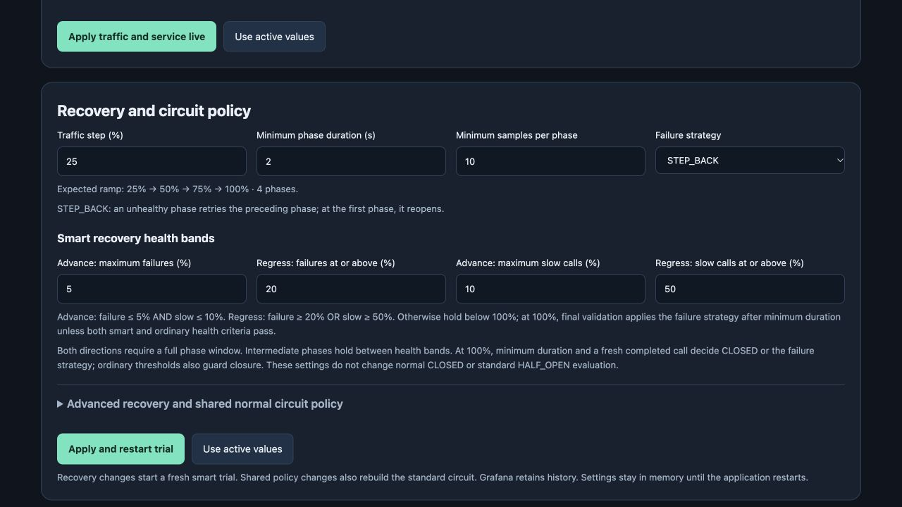
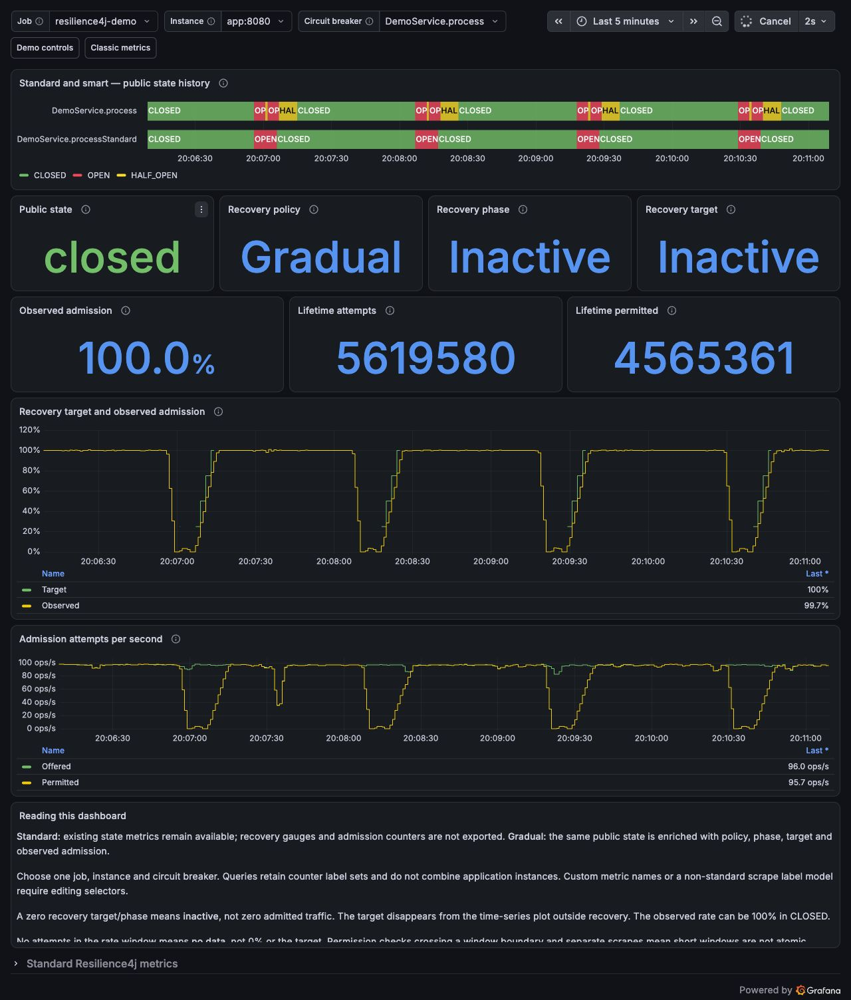

# Resilience4j lab

Run a Spring Boot 4.1.2 application on Java 25, generate traffic and inspect circuit recovery in a
local Grafana dashboard. Two independent circuit breakers exercise the same simulated
dependency: standard Resilience4j finite-probe recovery and an opt-in gradual policy.

```text
OPEN → HALF_OPEN (25% → 50% → 75% → 100%) → CLOSED
```

The gradual policy is an experimental extension in the
[public Resilience4j fork](https://github.com/xcapdevila/resilience4j/tree/contribution/phased-half-open-recovery-review).
This lab builds that custom version from source. The public circuit state stays
`HALF_OPEN` throughout the ramp; additional metrics show the target and actual
admission. Standard recovery remains available without the gradual policy.

## Preview

Change traffic, phase duration, sample size and failure strategy from the running
application. These are screenshots of the real local stack with synthetic traffic.



Grafana compares the standard and gradual state histories and shows the configured
recovery target alongside observed admission. This capture includes repeated outage
and recovery cycles; the selected circuit is CLOSED at the end of the time range.



## Quick start

Install Git, JDK 25 for the application, JDK 21 for the Resilience4j source build,
Python 3.9+ and a running local Docker engine with Compose.
The launcher supports macOS, Linux and WSL with a local Docker Unix socket. It uses
the checked-in Maven wrapper, so a separate Maven installation is unnecessary.

```sh
git clone https://github.com/xcapdevila/resilience4j-lab.git
cd resilience4j-lab
./local-lab/lab.sh bootstrap
./local-lab/lab.sh start
```

The launcher selects the two JDKs independently. If automatic discovery needs help,
set `PHASED_JAVA_HOME=/path/to/jdk-25` and
`PHASED_LIBRARY_JAVA_HOME=/path/to/jdk-21` before running the commands. Application
builds and tests use Java 25; the pinned library's Gradle build stays on Java 21.
`bootstrap` fetches the public library at the pinned revision
[`12a8bc6b6487e50af35a25759a20693965616ddf`](https://github.com/xcapdevila/resilience4j/commit/12a8bc6b6487e50af35a25759a20693965616ddf),
installs its custom `3.0.0-phased-SNAPSHOT` artifacts with the Spring Boot 4 adapter,
builds the application and
prepares the dashboards. Sources and build caches stay under this project's
`.lab-cache/`. `start` also prepares missing prerequisites and downloads the container
images. Later runs reuse the cache and service data volumes.

Open:

- [Application controls](http://localhost:8080/demo/lab/)
- [Grafana: classic metrics and gradual detail](http://localhost:3000/d/r4j-local-lab)
- [Grafana: classic metrics](http://localhost:3000/d/r4j-local-classic)
- [Prometheus](http://localhost:9090)

The default automatic cycle generates traffic, fails the dependency and restores it.
Watch the standard circuit close after its finite probe sample while the gradual
circuit validates successive admission targets. Grafana permits anonymous viewing;
use **admin / local-demo** to import or edit dashboards. The stack binds to loopback
and is intended for local development.

## Try different recoveries

The controls let you change requested RPS, concurrency, simulated success rates and
latency while traffic continues. Recovery controls include the percentage step,
minimum duration and completed samples per phase, initial target, health bands and
`OPEN` / `STEP_BACK` strategy. Applying recovery settings starts a fresh trial.
Draft edits stay separate from active settings; export or import JSON to save a trial.

Select a scenario:

| Scenario | Behavior |
|---|---|
| Automatic cycle | Repeat healthy traffic, an outage and recovery; wait for actual CLOSED before the next cycle |
| Healthy dependency | Send healthy traffic continuously |
| Outage | Keep the dependency failing |
| Errors during recovery | Inject a failure pulse after promotion to compare OPEN with STEP_BACK |
| Pause traffic | Stop generated requests while services and circuit timers remain active |

Presets cover quick recovery, low traffic, slow calls, concurrency pressure and a
longer provider-style recovery. **PSP recovery review** uses 25-point steps, 100
samples and a 60-second minimum per phase; its four healthy phases alone need at
least four minutes. All dependency behavior is synthetic. No external provider is
called, and the simplified backend does not model a provider queue or capacity curve.

The [lab guide](local-lab/README.md) lists every control, accepted range, preset,
dashboard import step and verification limit.

## What gradual recovery evaluates

Each phase needs a full rolling window of recorded completions. The default recovery
health bands are independent of the ordinary circuit thresholds:

| Decision | Failure rate | Slow-call rate |
|---|---:|---:|
| Eligible to advance | At most 5% | At most 10% |
| Regress | At least 20% | At least 50% |
| Hold below 100% | Between the bounds on either measure, without reaching a regression threshold | |

Advancement requires both healthy rates, the minimum phase duration and a fresh
recorded completion. Either regression threshold invokes the selected strategy once
the full sample window exists, even before minimum duration. `STEP_BACK` returns to
the preceding target, and reopens at the first target; `OPEN` reopens directly.

At 100%, the full sample window and minimum duration lead to a final validation on a
fresh completion. The circuit closes only when both recovery advance maxima pass
and both rates remain strictly below the ordinary thresholds. Otherwise it applies
its failure strategy. An intermediate health window therefore cannot hold 100%
indefinitely after those gates are met. With no fresh completions or too few samples,
validation can still remain pending; the optional total HALF_OPEN timeout bounds an
episode and reopens the circuit.

For example, with 100 samples and the default failure bands, 5 failures can permit
promotion, 6–19 hold an intermediate phase, and 20 invoke the failure strategy. At
100%, a window with 8 failures steps back or reopens after final validation. Slow-call
health must also pass. With only 10 samples, one failure is already 10%, so the default
5% advance maximum requires a clean failure window.

The compatible library API attributes outcomes to the state and phase current when
they complete. Calls admitted in an earlier phase can therefore contribute to the
current health window. Admissions continue across phase transitions; the lab does
not drain pending calls. The percentages control a share of attempts per circuit
instance, rather than an absolute rate or a fleet-wide capacity limit.

## Read the metrics

Select `DemoService.process` for gradual recovery or `DemoService.processStandard`
for the independent standard circuit. Both export the native public state, failure
and slow-call rates, recorded outcomes, rejected attempts and call durations.
Gradual recovery adds phase progress, target percentage and admitted/total attempt
counters. The dashboard derives observed admission from those counters over a time
window; it can differ from the current target when the window spans phase changes.

The combined dashboard also shows requested and actual offered RPS, in-flight calls,
skipped demand and completions. The generator skips excess demand when its concurrency
budget is exhausted, so requested RPS is not guaranteed throughput. Standard HALF_OPEN
can finish between one-second scrapes; the controls also display native transition
events. Smart-only panels are empty for the standard circuit.

## Source, tests and debugging

| Component | Source |
|---|---|
| Circuit-protected service | [DemoService.java](src/main/java/io/capdevila/poc/sr4j/DemoService.java) |
| Traffic generator and scenarios | [lab package](src/main/java/io/capdevila/poc/sr4j/lab) |
| Browser controls | [index.html](src/main/resources/lab/index.html) |
| Application and recovery tests | [test sources](src/test/java/io/capdevila/poc/sr4j) |
| Dashboard sources and provisioning | [local-lab](local-lab) |
| Gradual policy implementation | [public library fork](https://github.com/xcapdevila/resilience4j/tree/contribution/phased-half-open-recovery-review/resilience4j-circuitbreaker/src/main/java/io/github/resilience4j/circuitbreaker) |

```sh
./local-lab/lab.sh test
python3 -m unittest discover -s local-lab -p 'test_*.py'
./local-lab/lab.sh verify
./local-lab/lab.sh logs
./local-lab/lab.sh stop
```

`verify` reads the running current trial; it does not change its configuration. A long
recovery, paused traffic or insufficient samples can legitimately produce an
`INCOMPLETE` result within its wait budget. `stop` preserves the local data volumes.
Build dependencies, fetched sources, generated dashboards and reports are ignored.

The Java 25 / Spring Boot 4.1.2 migration was validated locally on 1 November 2026:
103 application tests, 20 offline script checks and 22 live application/Prometheus/
Grafana checks passed. The application uses the native Boot 4 adapter; its 13 pinned
library modules still compile with JDK 21 and produce Java 21 class files. These
checks verify this stack, rather than promise compatibility with future releases.

## Automated validation and releases

The [Lab validation workflow](.github/workflows/ci.yml) runs on pull requests, pushes
to `main`, manual requests and version tags. It checks the offline scripts, builds
the pinned public library with Java 21, builds and tests the application with Java
25, and starts the actual application, Prometheus and Grafana. Live checks cover an
automatic outage/recovery cycle and a fresh `STEP_BACK` trial with an observed native
phase regression. Build logs, test reports and live verification results are retained
as workflow artifacts for seven days, including failed runs.

A `vMAJOR.MINOR.PATCH` tag on a commit already in `main` can publish a GitHub release
only after those checks pass. The release includes the importable dashboard JSON;
GitHub provides source archives. A lab release versions this companion application,
not an official Resilience4j release. See the [release guide](docs/RELEASING.md) and
the [prepared first-release notes](docs/releases/v0.1.0.md).

For source overrides, alternative ports and manual dashboard import, see the
[lab guide](local-lab/README.md).

## License

[Apache License 2.0](LICENSE). See [NOTICE](NOTICE) for the Resilience4j dashboard and
Apache Maven Wrapper attribution. Dependencies and container images retain their
respective licenses.
